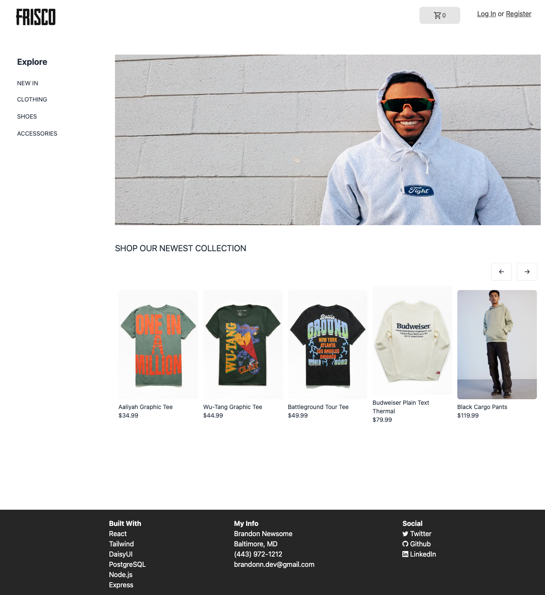
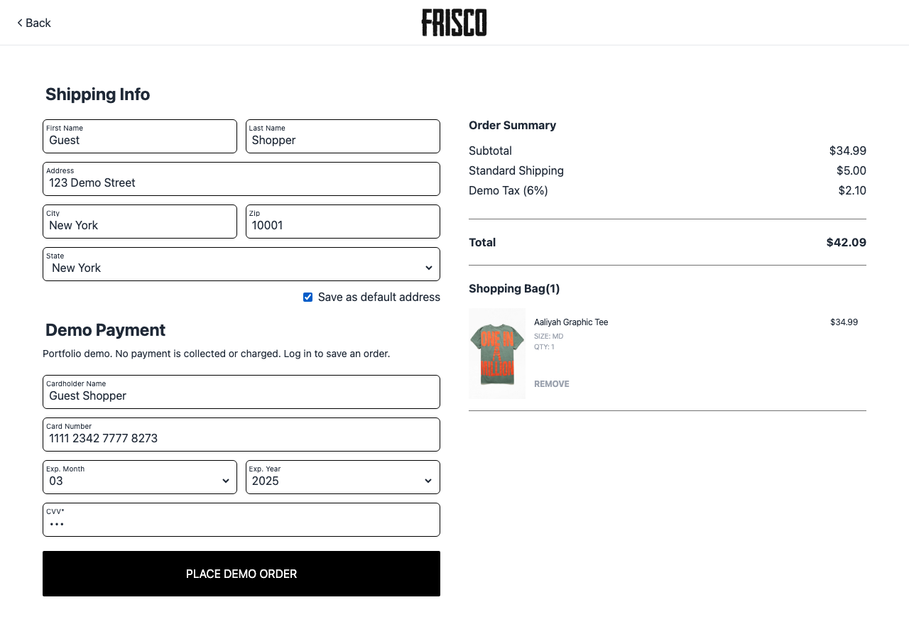
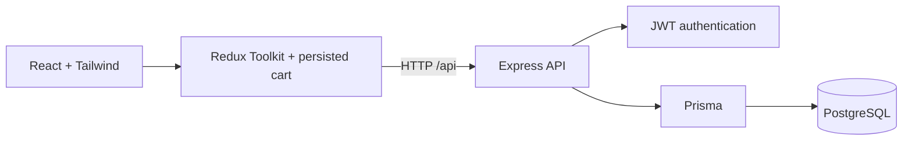

# Frisco Clothing Dept.

A full-stack streetwear storefront built with React, Redux Toolkit, Express, Prisma, and PostgreSQL. Browse a 50-product catalog, select sizes, keep a persistent shopping bag, and place demo orders tied to your account.



## Features

- Responsive product browsing with category filters, price sorting, and direct product links.
- Size-specific cart quantities and persistence across page reloads.
- Account registration and login with bcrypt password hashing and expiring JWTs.
- Saved shipping addresses and private order history.
- Server-calculated order totals using catalog prices, independent of client-supplied totals.
- A **Try Demo Account** button that creates a separate account for each visitor.
- Optional Google Maps address previews; the storefront works without a Maps key.

Checkout is a portfolio simulation. It records orders but does not process payments, manage inventory, or fulfill shipments. Use fictional address details.

## Run locally

Requirements: Node.js 22.12+ (Node 24 is configured in `.nvmrc`), npm, and PostgreSQL. Docker Compose can provide PostgreSQL.

```sh
cp .env.example .env.local
# Replace JWT_SECRET in .env.local with a random secret.
# Generate one with: node -e "console.log(require('crypto').randomBytes(32).toString('hex'))"
npm run setup
docker compose up -d --wait
npm run db:migrate
npm run db:seed
npm run dev
```

Open **http://127.0.0.1:5173**. The API listens on port **5001**, avoiding the common macOS port 5000 conflict. The database uses port **5433**. For an existing PostgreSQL instance, skip Docker and set `DATABASE_URL` to an empty database you own.

Configuration loads process environment variables first, then `.env.local`, then `.env`. Local environment files are ignored by Git. The original `.env` can stay in place; `.env.local` overrides its values. If you change `PORT`, restart `npm run dev` so the Vite proxy receives the new value.

This workspace also has an isolated native PostgreSQL instance at `.local/postgres`. To restart it on this Mac:

```sh
/opt/homebrew/opt/postgresql@18/bin/pg_ctl -D .local/postgres -l .local/postgres.log -o '-h 127.0.0.1 -p 5433 -k /tmp' start
```

Use either that instance or Docker on port 5433. Its data and local configuration are excluded from version control. Stop the native instance with `pg_ctl -D .local/postgres stop` using the same PostgreSQL binary directory.

For optional Maps previews, copy `client/.env.example` to `client/.env.local` and provide a browser-restricted Google Maps API key with Maps JavaScript and Geocoding enabled. Restart Vite afterward.

## Try the demo

1. Browse the newest collection or a category and open a product.
2. Select a size and add it to your bag.
3. Open Login and choose **Try Demo Account**, or register your own account.
4. Open your bag, proceed to checkout, and enter fictional shipping information.
5. Place the demo order, then open Account → Orders to see its saved record.



## Architecture



The Vite development server proxies `/api` to Express. In production, Express serves the compiled React app and API from the same origin. Product images ship with the client; catalog records and account data live in PostgreSQL. Demo totals include $5 shipping and a fixed 6% simulated tax; these are demonstration rules, not a real tax calculation. Orders store snapshots of catalog products so their details remain available in order history.

| Path | Purpose |
| --- | --- |
| `client/src` | Storefront components, pages, and Redux state |
| `controllers`, `routes`, `middleware` | API handlers and authentication |
| `prisma` | Data model, schema migrations, and repeatable catalog seed |
| `tests` | Authentication, catalog, API integration, and browser checks |
| `docs/RESUME.md` | Resume bullets and interview walkthrough |

## Verify

```sh
npm test
npm run test:integration
npm run build
npx playwright install chromium
npm run test:browser
# Optional: exercise the compiled app served directly by Express.
TEST_PRODUCTION=1 PORT=5173 NODE_ENV=production npm run test:browser
```

Integration and browser tests require a migrated, seeded development database. They create temporary accounts and remove their account, address, and order records afterward. Browser checks cover direct product URLs, persisted cart, demo registration, failed-order recovery, successful checkout, order history, and mobile layout. GitHub Actions runs these checks against a fresh PostgreSQL database; its workflow is included in `.github/workflows/ci.yml`.

`npm run db:seed` updates existing seeded products by name without deleting accounts or orders. `npm run db:push` is available for local schema experiments. For an existing database, review migration history and duplicate emails before applying migrations; do not reset a database containing data you need.

## Production build

```sh
npm run setup
npm run build
npm run db:migrate
npm run db:seed
NODE_ENV=production npm start
```

Set `DATABASE_URL`, a private `JWT_SECRET`, and the hosting platform's `PORT` through its environment settings. The deployment needs Node.js and PostgreSQL. No deployment URL is claimed here; this repository currently provides the local demo and deployment commands.

## Engineering tradeoffs and next work

- Payment fields are sample values. Real payments would require a provider integration and verified webhooks.
- JWTs are stored in browser local storage. A public production service should add HTTP-only cookie sessions, abuse protection, account recovery, and an explicit data retention policy.
- Monetary values remain strings in the original schema; checkout calculates totals in integer cents. Decimal database fields and transaction-backed inventory would support a larger commerce system.
- The backend audit is clean after dependency updates. The frontend still has audit findings in the Tailwind 3 build dependency chain; moving the styling system to Tailwind 4 is a separate migration. Re-run `npm audit` in each package before deployment.
- Product and brand imagery is demo content. Confirm image usage rights before commercial use.
