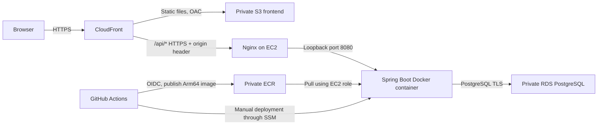

# Frisco Clothing Dept.

A full-stack clothing storefront migrated from Express/Prisma to Java 21 and
Spring Boot, with a React/TypeScript frontend and an AWS deployment defined in Terraform.

**[Live storefront](https://dsf3uar9gd5k6.cloudfront.net)** ·
[Deployment runbook](docs/DEPLOYMENT.md) · [Order API notes](docs/ORDER_MIGRATION.md)

This is a portfolio demo. Checkout records orders but collects no payment.

## Features

- Product browsing, categories, price sorting, and size selection.
- Persistent browser shopping bag, including across logout.
- Registration and session-based login/logout with CSRF protection.
- Account profile, saved shipping address, and order history.
- Server-calculated order totals and purchase-time product/price snapshots.

## Architecture



The CI/CD additions and production hardening must be applied using the runbook;
committing their definitions does not configure live AWS resources automatically.
The DuckDNS hostname is a backend origin; visitors use the CloudFront URL above.

## Stack

- **Frontend:** React, TypeScript, Vite, Redux Toolkit/RTK Query, Redux Persist, Tailwind/DaisyUI.
- **Backend:** Java 21, Spring Boot, Spring Security, Bean Validation, JPA/Hibernate, PostgreSQL.
- **Delivery:** multi-stage Docker build, Compose, ECR, GitHub Actions, OIDC, Systems Manager.
- **Infrastructure:** Terraform, S3, CloudFront, EC2, private RDS, IAM, Nginx/Let's Encrypt.

## Run locally with Docker

Requires Docker with Compose. From the repository root:

```sh
docker compose up --build -d
curl -sS http://127.0.0.1:8081/api/products | python3 -m json.tool
```

This creates an isolated PostgreSQL 17 container and named volume. The backend is
bound to `127.0.0.1:8081`; it does not use your installed PostgreSQL or AWS database.
The committed `frisco_local` password is for this local container only.

Run the frontend in a second terminal, proxying API calls to that backend:

```sh
cd client
npm ci
FRISCO_API_TARGET=http://127.0.0.1:8081 npm run dev
```

Open the Vite URL printed in the terminal. Default API target remains
`http://127.0.0.1:8080` for a Java backend running directly on the host.

```sh
docker compose down
```

Stopping the stack preserves its database volume. Avoid `down -v` unless you
intend to delete local demo data. To rebuild the backend image, include `--build`.

## Run Java directly

Provide a separate local PostgreSQL database. The defaults are `frisco_dev` on
localhost:5432 and username `losandies`; override using `DB_URL`, `DB_USERNAME`, and
`DB_PASSWORD`. The URL must use JDBC syntax.

```sh
cd backend-java
bash ./mvnw spring-boot:run
```

The `prod` profile validates an already-existing schema and sets secure cookies;
local development retains automatic schema updates. See the runbook before using
production settings or connecting to RDS. Never use production credentials locally.

## Verification

```sh
cd backend-java
bash ./mvnw -B verify
```

```sh
cd client
npm ci
npm run typecheck
npm run build
```

From the repository root:

```sh
python3 -m unittest discover -s infra/ec2/tests -v
bash infra/ec2/smoke-test.sh
```

Backend integration tests use H2, not RDS; PostgreSQL-specific behavior still needs
validation against PostgreSQL. Deployment regression tests mock the CLIs and do
not change AWS. Public smoke checks are read-only and should run after applying
production configuration. Authenticated checkout flows are also tested manually.

## Repository

| Path | Purpose |
| --- | --- |
| `client/` | React/TypeScript application |
| `backend-java/` | Spring Boot application, tests, Dockerfile |
| `compose.yaml` | Isolated local backend/database stack |
| `compose.ec2.yaml` | Versioned backend-only deployment using RDS |
| `infra/terraform/` | Main AWS infrastructure and GitHub OIDC roles |
| `infra/state-bootstrap/` | Private, encrypted, versioned state bucket |
| `infra/ec2/` | Deployment scripts and secret-free host configuration templates |
| `.github/workflows/` | CI, image publishing, manually triggered deployment |
| `legacy/express/` | Original Express/Prisma implementation retained for reference |

## Engineering decisions and limits

Session cookies keep credentials out of browser storage. CloudFront provides one
public origin for frontend and API, forwards session/CSRF data, and disables API
caching. EC2 runs a non-root container with a memory limit and rotated logs.
RDS is private and accepts database connections only from the backend group.

The deployment script pulls an explicit immutable image tag, checks readiness, and
restores the previous image on failure. This is a single-instance deployment:
updates briefly interrupt service, sessions reset on Java restart, and image
rollback cannot reverse schema changes. Full schema migrations, automatic host
bootstrap, restore drills, and centralized monitoring remain follow-ups. The
[runbook](docs/DEPLOYMENT.md) documents setup, operator steps, and evidence limits.
