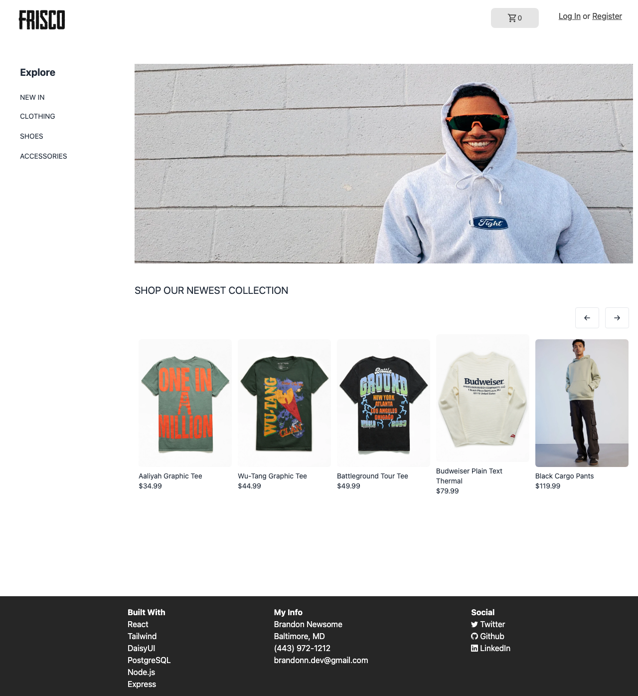

# Frisco Clothing Dept.

Frisco Clothing Dept. is a full-stack streetwear storefront built with React, TypeScript, and Spring Boot. Browse the catalog, choose a size, and add items to a shopping bag that persists across visits. Register for an account to save a shipping address, place an order, and view your order history. Checkout records demo orders without collecting payment.

**[Try the live demo](https://dsf3uar9gd5k6.cloudfront.net/)**



## How it works

- **Storefront** uses React Router, Tailwind CSS, and DaisyUI. RTK Query handles API requests, and Redux Persist stores the shopping bag in the browser.
- **API** runs on Java 21 with Spring Boot, Spring Security, and Spring Data JPA. Authentication uses server-side sessions and CSRF protection. The API calculates totals from catalog prices and saves purchase-time product details and prices with each order.
- **AWS hosting** uses CloudFront to serve the frontend from private S3 and route `/api/*` over HTTPS to Nginx on EC2. The Spring Boot container connects to private RDS PostgreSQL. Terraform defines the infrastructure, and the EC2 deployment script pulls versioned backend images from ECR.

## Run the storefront locally

Use Java 21, Node.js 24, and a running local PostgreSQL instance. Create a database and give your local database user permission to create tables. From the repository root, start the API with your database settings.

```sh
cd backend-java
export DB_URL=jdbc:postgresql://localhost:5432/frisco_dev
export DB_USERNAME=your_local_postgres_user
export DB_PASSWORD=your_local_postgres_password
bash ./mvnw spring-boot:run
```

The API creates the local schema and seeds products when the catalog is empty. In a second terminal, from the repository root, start the frontend.

```sh
cd client
npm ci
npm run dev
```

Open [http://127.0.0.1:5173](http://127.0.0.1:5173). Vite forwards `/api` requests to the backend on port `8080`. For the optional address map, use `client/.env.example` as a template for `client/.env.local` and set `VITE_GOOGLE_API_KEY`.

### Run the API with Docker

To run just the API and PostgreSQL in containers, start the stack from the repository root.

```sh
docker compose up --build -d
curl --fail http://127.0.0.1:8081/api/products
```

This setup exposes the API on port `8081`. Run `docker compose down` to stop the stack. The database persists in a named volume.

## Checks

GitHub Actions runs the Java verification suite and the frontend type check and build. Run the same checks from the repository root.

```sh
(cd backend-java && bash ./mvnw -B verify)
(cd client && npm ci && npm run typecheck && npm run build)
```

## Repository layout

| Path | Contents |
| --- | --- |
| [`client/`](client/) | Storefront, shopping bag, checkout, and account UI |
| [`backend-java/`](backend-java/) | Spring Boot API, product data, and tests |
| [`infra/terraform/`](infra/terraform/) | AWS infrastructure |
| [`infra/ec2/`](infra/ec2/) | Backend deployment script and host configuration templates |
| [`legacy/express/`](legacy/express/) | Archived Express and Prisma implementation |

[Order API documentation](docs/ORDER_MIGRATION.md)
